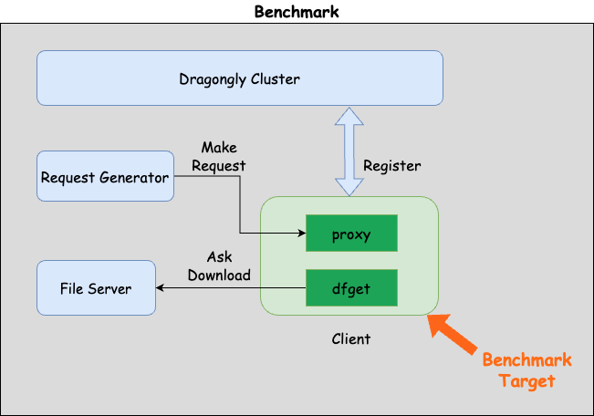

# Performance Optimization Guidance

This is a reference benchmark process document designed to
assist in performance analysis and optimization for **client**.
This document provides as general a testing framework as possible,
allowing developers with needs to adjust it
according to their specific circumstances across various platforms.

## Flow



## Preparation

### Step 1: Setup Dragonfly

- Please refer to [official doc](https://d7y.io/docs/next/getting-started/installation/helm-charts/).

### Step 2: Start a file server

- Start with docker:

```bash
export FILE_SERVER_PORT=12345
docker run -d  --rm -p ${FILE_SERVER_PORT}:80 --name dragonfly-fs dragonflyoss/file-server:latest
```

- Check the file server is ready:

```bash
# return success if ready
curl -s -o /dev/null \
     -w "%{http_code}" \
     http://localhost:12345/nano \
| grep -q "200" \
&& echo "Success" \
|| echo "Failed"
```

- Optional:

> you can build your own image, take a reference from [**Dockerfile**](https://github.com/dragonflyoss/perf-tests/blob/main/tools/file-server/Dockerfile).

### Step 3: Install test tools

- Request Generator: [**oha**](https://github.com/hatoo/oha)

```bash
brew install oha
```

- Profiling: [**flamegraph**](https://github.com/flamegraph-rs/flamegraph)

```bash
cargo install flamegraph
```

### Step 4: Setup Dragonfly Peer

> Document: [Install with binary](https://d7y.io/docs/next/getting-started/installation/binaries/).

- Compile the target binary

```bash
cargo build --release --bin dfdaemon
```

- Connect to Dragonfly

```bash
# prepare client.yaml by yourself.
./target/release/dfdaemon --config client.yaml -l info --console
```

## Concurrent Piece Writes

`download.concurrentPieceCount` controls concurrent piece downloads. Network
receive and CRC32 calculation can overlap disk writes. Prepared write batches
are serialized per `(device, inode)` within the dfdaemon process, including
writes through separately opened descriptors and hardlink aliases. Different
files can submit writes concurrently.

The reader path fills staging buffers, while the stream path batches `Bytes`
chunks without copying them before submitting positional writes. Both use
`storage.writeBufferSize` as the batching threshold and share the inode gate.
The gate is acquired after a batch is ready and held only for its blocking
write, including partial-write retries. Receiving data, hashing and configured
writeback run outside the gate. The existing receive/write pipeline and buffer
reuse remain in place.

Cancelling or timing out a download cannot cancel a blocking write that has
already started. That write retains the inode gate until it finishes, so a
retry waits before submitting another batch. This gate controls data submission;
piece completion and writeback retain their existing semantics. It does not
provide serialization with writers in other processes or a persistence guarantee.

### Comparing write contention

Compare the baseline and modified binaries on the same Linux/XFS host. Keep
the input file, piece length, write buffer size, source/peer path, filesystem,
kernel, storage layout and cache conditions fixed. Run a single task at piece
concurrency `1`, `4`, `8`, `16` and `32`, and repeat each case at least three
times. Ensure each run actually downloads and writes the data rather than
returning an already completed task. Use a separately prepared benchmark cache
directory; preserve operational caches.

Record end-to-end throughput, process and host CPU seconds per GiB, write
syscall counts and sizes, and kernel profiles with the write-lock wait stacks.
Also record writeback mode, dirty-page pressure and device traffic: completion
of buffered writes alone does not measure sustained disk throughput.

Accept the change when the target write-lock waits and CPU per GiB decrease
and throughput does not regress beyond observed run-to-run variation. Unit
tests establish serialization and data correctness; throughput and CPU benefits
remain unverified until this comparison is run on the target environment.

## Collecting a FlameGraph

Now, let's start benchmark with the following params:

- $FILE_SERVER_ADDRESS
- $CLIENT_PROXY_ADDRESS

### Collect Flamegraph

- Capture the flamegraph:

```bash
## stop after all requests done.
sudo flamegraph -o my_flamegraph.svg --pid 3442
```

- Make the request:

```bash
oha -c 1000 \
    -n 100 \
    --rand-regex-url $FILE_SERVER_ADDRESS/\(nano\|micro\|small\|medium\|large\) \
    -x $CLIENT_PROXY_ADDRESS
```
